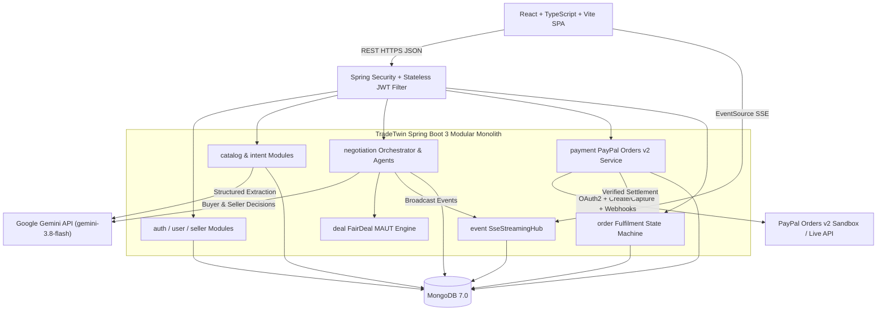
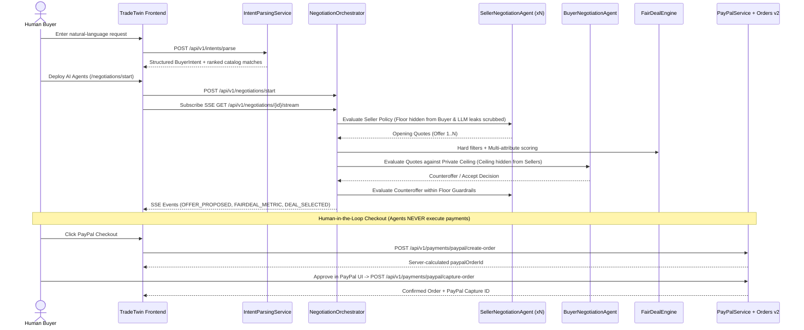
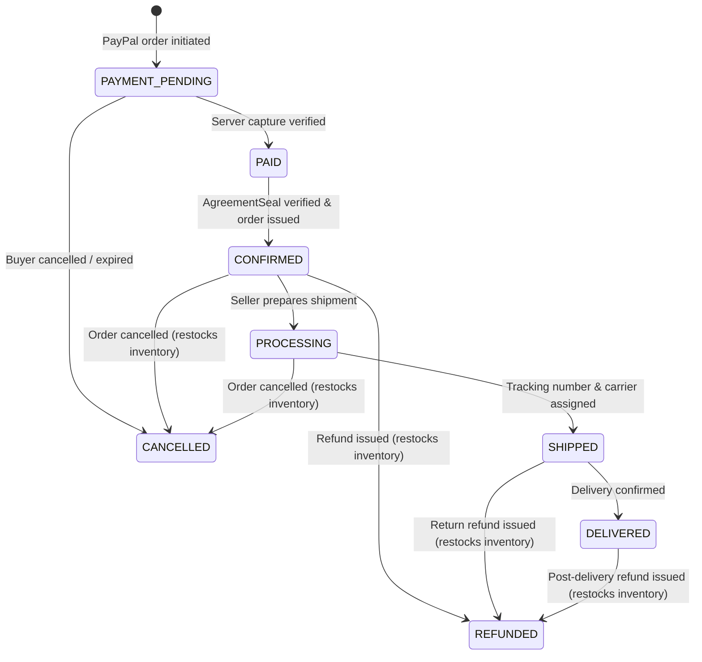

# TradeTwin System Architecture

TradeTwin is designed as a **Modular Monolith** balancing domain isolation, cryptographic/financial safety, and operational simplicity for local and cloud deployment.

---

## 1. High-Level System Architecture

---

## 2. Multi-Agent Negotiation & FairDeal Checkout Sequence

---

## 3. Controlled Order Fulfilment State Machine

---

## 4. Modular Package Responsibilities

| Module | Package (`com.tradetwin.*`) | Core Responsibilities |
|---|---|---|
| Authentication | `auth` | BCrypt registration/login, stateless HS256 JWT filter, RBAC (`ROLE_BUYER`, `ROLE_SELLER`, `ROLE_ADMIN`) |
| Users | `user` | Buyer profile, default currency, shipping address, shopping preferences |
| Sellers | `seller` | Seller onboarding store profile, shipping regions, default strategy, seller KPI dashboard summary |
| Catalog | `catalog` | Product CRUD, image galleries, stock management, private `NegotiationPolicy`, deterministic search ranking |
| Intent | `intent` | Gemini-assisted NL query parsing with heuristic fallback and follow-up ambiguity prompts |
| Negotiation | `negotiation` | Autonomous `BuyerNegotiationAgent`, `SellerNegotiationAgent`, and `NegotiationOrchestrator` loop |
| FairDeal | `deal` | Mandatory hard filters (budget, inventory, MOQ) + weighted transparent multi-attribute scoring + `AgreementSeal` |
| Real-Time Events | `event` | `SseStreamingHub` managing live browser `SseEmitter` streams + MongoDB audit event log |
| Payments | `payment` | PayPal OAuth2 token cache, Orders v2 create/capture/lookup, cancel/decline logging, idempotency, webhook verification |
| Orders | `order` | Controlled `OrderStateMachine`, inventory deduction/restock, shipment tracking, buyer dashboard summaries |
| Common | `common` | Global exception mapping (`GlobalExceptionHandler`), CORS config, health actuator, demo `DataInitializer` |

---

## 5. Non-Negotiable Guardrails

1. **Private Threshold Isolation**:
   - Seller `floorPrice` and `autoAcceptPriceThreshold` are omitted from `ProductPublicDto`, search responses, SSE events, and buyer payloads.
   - Buyer `maxCeilingPrice` is never passed to `SellerNegotiationAgent`, omitted from public `NEGOTIATION_STARTED` SSE broadcasts and `Turn.agentReasoning`, and masked from unauthenticated or non-owner callers on `GET /api/v1/negotiations/{id}` and `GET /api/v1/intents/{id}`.
2. **Zero-Trust Validation of LLM Decisions**:
   - Every AI counteroffer or acceptance is clamped/overruled server-side with `java.math.BigDecimal` (`RoundingMode.HALF_UP`) against private floor/ceiling bounds.
   - Explanations are scrubbed before persistence or SSE emission so threshold values do not leak in natural language.
3. **Human-in-the-Loop Financial Settlement**:
   - Negotiating agents can only advance to `ACCEPTED` / `AGREED` with a 15-minute `AgreementSeal`.
   - Final payment creation and capture require explicit human buyer action and server-side PayPal amount recalculation.
